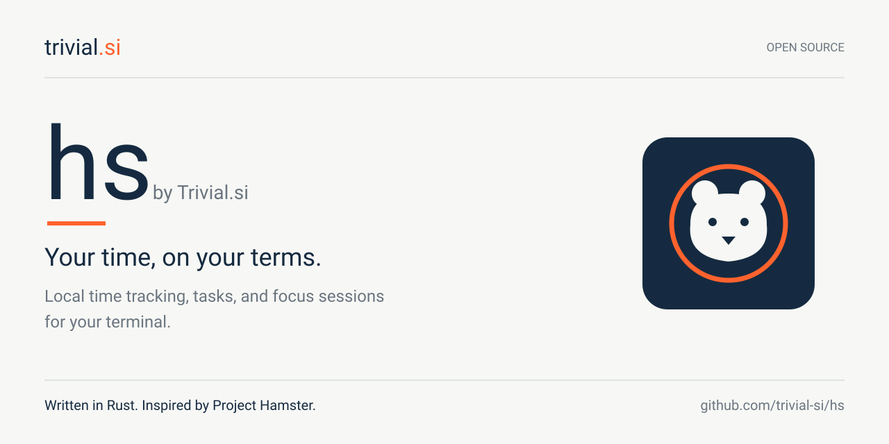

# hs — your time, on your terms

Local time tracking, tasks, and focus sessions for your terminal. Written in Rust. Inspired by [Project Hamster](https://github.com/projecthamster/hamster).

[](https://github.com/trivial-si/hs/actions/workflows/ci.yml)
[](LICENSE)

**hs by [Trivial.si](https://trivial.si)** stores your tasks and time in a local SQLite database. Start from the command line or use the keyboard-driven terminal interface. Timers survive closing the terminal and restarting the computer.

- Track activities with categories and tags; report and export your history.
- Organize tasks in an Eisenhower matrix and track time against them.
- Run Pomodoro focus sessions and breaks with optional sound.
- Import existing Hamster schema-v9 history into a separate database.
- Use the JSON API or local MCP server when you want an agent to help.

**Status:** early development, with Linux as the supported platform for this initial release. Interfaces may evolve before 1.0; database and behavior changes are documented in the [changelog](CHANGELOG.md). Keep backups of important history.

## Get started

Build from source with Rust 1.88 or newer and a C compiler for the bundled SQLite library:

```sh
git clone https://github.com/trivial-si/hs.git
cd hs
cargo build --release --locked
install -Dm755 target/release/hs "$HOME/.local/bin/hs"
```

Ensure `~/.local/bin` is on your `PATH`. Then try:

```sh
hs start 'Writing@Work, #project'
hs stop
hs list --today
```

Or plan a task and open the terminal interface:

```sh
hs task add 'Finish the proposal' --quadrant plan
hs tui
```

Press `?` for keyboard help. Select a task and press `s` to track it or Space to start a focus session. Quitting leaves the timer saved.

The default database is `~/.local/share/hs/hs.db` (or under an absolute `XDG_DATA_HOME`). Use `hs --db ./trial.db …` to experiment with a separate database. Use `hs backup ./hs-backup.db` to create a consistent backup at a new path.

## Coming from Hamster?

I built hs because I loved Project Hamster's simple approach to tracking time. This independent Rust implementation carries that inspiration into the terminal, with task planning, focus sessions, and an importer for existing history.

hs is developed independently of Project Hamster. Thank you to the Hamster developers and contributors who made the original possible.

Read the [migration guide](docs/hamster.md) for supported schemas, a trial import, and behavior differences. See [upstream credits](NOTICE).

## Documentation

- [User guide](docs/guide.md): tracking, tasks, TUI, Pomodoro, reports, backup, and completion.
- [Hamster migration](docs/hamster.md): importing existing history.
- [JSON API and MCP](docs/agents.md): local agent integration and write safeguards.
- [Architecture](docs/architecture.md): where the code lives and how it fits together.
- [Roadmap](ROADMAP.md) and [release history](CHANGELOG.md).

## Contribute

Bug reports, documentation, testing, design, and code are welcome. Start with [CONTRIBUTING.md](CONTRIBUTING.md) or the [good first issues](https://github.com/trivial-si/hs/labels/good%20first%20issue). You do not need to be a Rust expert to help.

Use [issues](https://github.com/trivial-si/hs/issues) for reproducible bugs and scoped proposals, and [discussions](https://github.com/trivial-si/hs/discussions) for questions and ideas. Please follow the [code of conduct](CODE_OF_CONDUCT.md). Report vulnerabilities through the [security policy](SECURITY.md).

## License

[GPL-3.0-or-later](LICENSE). See [NOTICE](NOTICE) for Project Hamster attribution and asset provenance.
